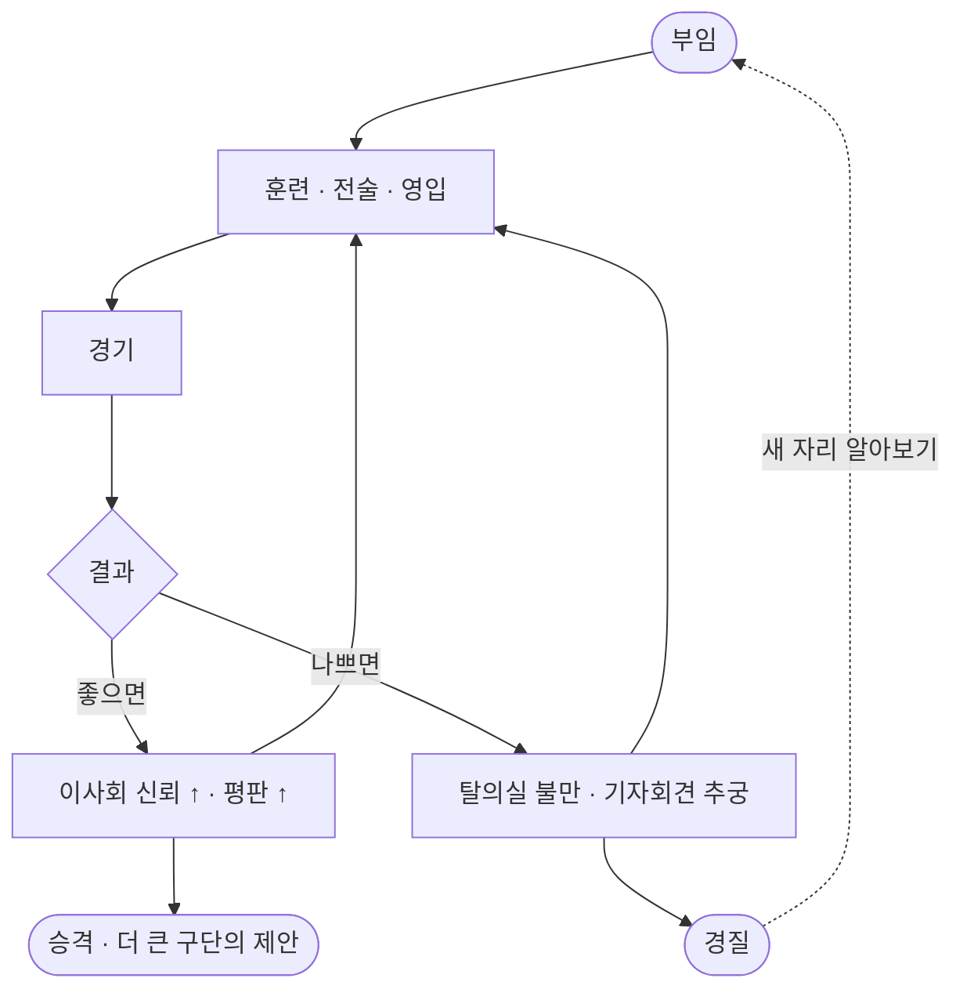
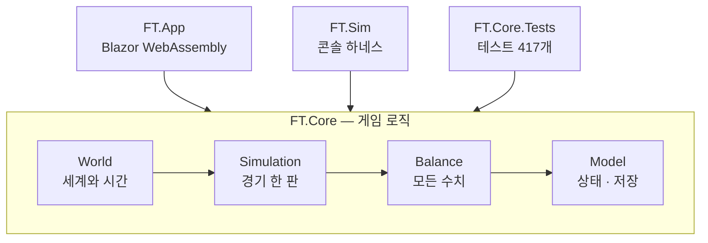

# Football Tactician

**브라우저에서 바로 돌아가는 축구 감독 시뮬레이션.** 설치도, 내려받기도, 계정도 없습니다.

### ▶ [지금 해 보기](https://sundae-unity-dev.github.io/Football-TacticManager/)

3부 리그의 작은 구단에서 시작합니다. 선수를 키우고, 전술을 짜고, 승격시키고, 컵을 들고,
평판을 쌓아 1부 명문으로 옮겨 갑니다. 성적이 나쁘면 경질됩니다.



| | |
|---|---|
| 나라 | **49개국** 중에서 고릅니다 — 잉글랜드부터 뉴질랜드까지 |
| 구단 · 선수 | 기본 **240 · 6,000** — 나라를 더 넣을수록 늘어납니다(최대 1,520 · 38,000) |
| 컵 | 나라마다 국내 컵 60팀 + 대륙 챔피언스컵 |
| 저장 | **브라우저 안에만.** 서버로 아무것도 가지 않습니다 |
| 지금 버전 | **v0.5.0** · [바뀐 것](CHANGELOG.md) |

**나라와 도시 이름만 실제**이고 리그·구단·선수는 전부 가상입니다. 선수 이름은 한글로 나옵니다 — 언어권마다 읽는 법이 다릅니다.
실제 리그·구단·선수 이름에 대한 라이선스가 없고, 실제 리그의 구조를 베끼지도 않습니다.

## 어떻게 만들어져 있나

C# 한 벌로 **데스크톱(측정·밸런싱)과 브라우저(플레이)를 같이** 돌립니다.
게임 로직은 화면도 플랫폼도 모릅니다.



화살표는 "참조한다" 방향이고 **한 방향으로만** 흐릅니다. 자세한 사정은
[구조](docs/구조.md)에 있습니다.

## 실행

```bash
dotnet run --project FT.App          # http://localhost:5xxx
dotnet test FT.Core.Tests            # 회귀 테스트

# 배포본. wasm-tools 워크로드가 필요합니다.
# 윈도에서는 AOT 때문에 20분쯤 걸립니다 — 리눅스 러너에서는 같은 일이 2분입니다.
dotnet publish FT.App -c Release -o publish
```

브라우저 수치는 `publish` 한 결과로만 재세요(개발 서버는 디버깅이 켜져 있어 열일곱 배
느리게 나옵니다). 띄운 뒤 **`/perf`** 로 가면 저장을 세 번 재고 조각별로 쪼개 줍니다 —
메뉴에는 없고 주소를 직접 쳐야 들어옵니다.

## 읽을 것

글이 길어서 나눠 두었습니다. **필요한 것만 누르세요.**

| | |
|---|---|
| 🧱 [구조](docs/구조.md) | 프로젝트 네 개가 어떻게 나뉘는지 · 참조 방향 · 결합도를 재서 고친 기록 |
| ⚡ [성능](docs/성능.md) | 데스크톱과 브라우저에서 잰 값 · 저장을 다섯 배 빠르게 한 과정 |
| ⚖️ [밸런싱](docs/밸런싱.md) | 20시즌을 돌려 수치를 맞추는 하네스 · 시드와 지문 |
| 🚀 [배포](docs/배포.md) | 버전 올리는 순서 · Actions 자동 배포 · Pages 의 함정 |
| 🩹 [건드릴 때 조심할 것](docs/조심할-것.md) | **한 번씩 데여서 적어 둔 것.** 고치기 전에 해당 묶음만 펼쳐 보세요 |
| 📒 [바뀐 것](CHANGELOG.md) | 버전마다 무엇이 달라졌는지 |
| 📐 [기획서](docs/기획서-v23.0.html) | 설계 문서 (v23.0) |

## 아직 없는 것

모델만 있고 쓰이지 않는 타입은 하나도 없습니다 — 2026-10-29 에 마지막(홈그로운)까지 연결했습니다.

세계에 외국인 선수가 없습니다. 생성 시 모든 구단이 자국 선수로만 채워지고,
외국인은 나라 간 이적으로만 생깁니다. 홈그로운 규정을 국적이 아니라
클럽 유스로 세는 이유이기도 합니다.

감독이 직접 치르는 경기는 5분 단위 블록이라 분 단위 지시는 없습니다.

## 라이선스

정해 둔 것이 없습니다. 쓰실 일이 있으면 먼저 물어봐 주세요.
