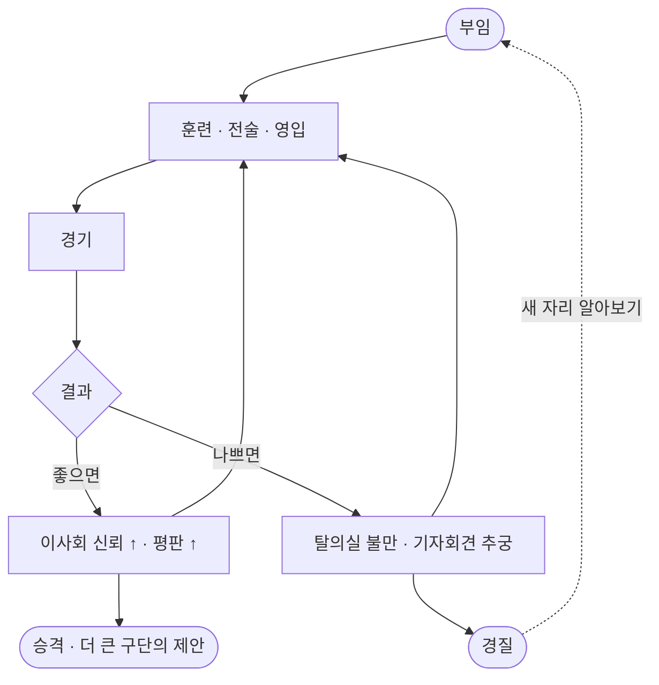
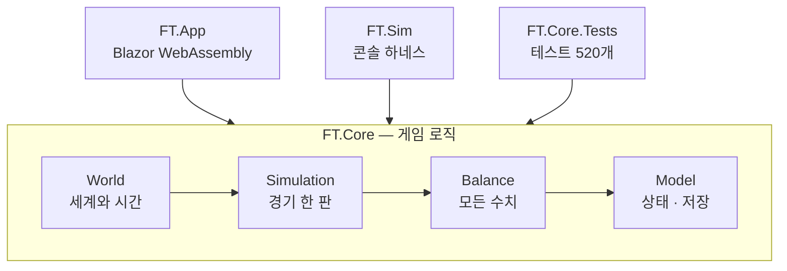

# Football Tactician

**브라우저만 있으면 바로 해 볼 수 있는 축구 감독 게임이에요.** 설치할 것도, 내려받을 것도, 가입할 것도 없어요.

### ▶ [지금 해 보기](https://sundae-unity-dev.github.io/Football-TacticManager/)

처음엔 3부 리그의 작은 구단을 맡게 돼요. 선수를 키우고 전술을 짜서 승격도 하고 컵도 들어 올리다 보면,
평판이 쌓여서 1부 명문 구단에서 연락이 와요. 물론 성적이 나쁘면 잘리기도 하고요.



| | |
|---|---|
| 나라 | **175개국** 중에서 골라요 — 6대륙, 잉글랜드부터 통가까지 |
| 구단 · 선수 | 기본은 **240 · 6,000** 이고, 나라를 더 넣을수록 늘어나요(전부 넣으면 4,105 · 102,625) |
| 컵 | 나라마다 국내 컵이 있고, **대륙마다 챔피언스컵**도 있어요 (유럽·남미·북중미·아시아·아프리카·오세아니아) |
| 저장 | **브라우저 안에만 저장돼요.** 서버로는 아무것도 보내지 않아요 |
| 지금 버전 | **v0.19.0** · [바뀐 것](CHANGELOG.md) |

**실제인 건 나라와 도시 이름뿐이고**, 리그·구단·선수는 전부 지어낸 거예요. 선수 이름은 한글로 나오는데,
언어권마다 읽는 법을 따로 맞춰 뒀어요. 실제 리그·구단·선수 이름을 쓸 라이선스가 없어서 그렇기도 하고,
실제 리그 구조를 그대로 베끼는 것도 목표가 아니라서요.

## 어떻게 만들었나요

C# 코드 한 벌로 **데스크톱(측정·밸런싱)과 브라우저(플레이)를 함께** 돌려요.
게임 로직은 화면이 뭔지, 어느 플랫폼에서 도는지 전혀 몰라도 되게 짜 뒀어요.



화살표는 "이쪽이 저쪽을 참조한다"는 뜻이고, **한 방향으로만** 흘러요. 왜 이렇게 나눴는지는
[구조](docs/구조.md)에 자세히 적어 뒀어요.

## 직접 돌려 보려면

```bash
dotnet run --project FT.App          # http://localhost:5xxx
dotnet test FT.Core.Tests            # 회귀 테스트

# 배포본이에요. wasm-tools 워크로드가 있어야 해요.
# 윈도에서는 AOT 때문에 20분쯤 걸려요 — 같은 일이 리눅스 러너에서는 2분이면 끝나요.
dotnet publish FT.App -c Release -o publish
```

브라우저에서 속도를 잴 때는 꼭 `publish` 한 결과로 재 주세요. 개발 서버는 디버깅이 켜져 있어서
열일곱 배쯤 느리게 나오거든요. 띄운 다음 **`/perf`** 로 들어가면 저장을 세 번 재서 단계별로 쪼개 보여 줘요.
메뉴에는 없어서 주소창에 직접 쳐야 해요.

## 더 읽어 볼 것

한 문서에 다 넣으니 너무 길어서 나눠 놨어요. **궁금한 것만 골라 보시면 돼요.**

| | |
|---|---|
| 🧱 [구조](docs/구조.md) | 프로젝트 네 개를 어떻게 나눴는지, 참조 방향, 결합도를 재 가며 고친 기록 |
| ⚡ [성능](docs/성능.md) | 데스크톱과 브라우저에서 잰 값, 저장을 다섯 배 빠르게 만든 과정 |
| ⚖️ [밸런싱](docs/밸런싱.md) | 20시즌을 돌려 가며 수치를 맞추는 하네스, 시드와 지문 이야기 |
| 🏆 [리그 제도](docs/리그-제도.md) | 나라마다 다른 팀 수·승강·스플릿·플레이오프와, 그중 무엇을 넣었는지 |
| 🎨 [UI 개선 분석](docs/UI-개선-분석.md) | FM24 화면을 뜯어보면서 우리 화면에 무엇을 가져올지 정리한 것 |
| 🚀 [배포](docs/배포.md) | 버전 올리는 순서, Actions 자동 배포, Pages 에서 걸리기 쉬운 함정 |
| 🩹 [건드릴 때 조심할 것](docs/조심할-것.md) | **한 번씩 크게 데이고 나서 적어 둔 것들이에요.** 고치기 전에 그 부분만 펼쳐 보세요 |
| 📒 [바뀐 것](CHANGELOG.md) | 버전마다 무엇이 달라졌는지 |
| 📐 [기획서](docs/기획서-v23.0.html) | 처음 설계할 때 쓴 문서 (v23.0) |

## 아직 없는 것

만들어 놓고 안 쓰는 타입은 이제 하나도 없어요. 2026-10-29 에 마지막 남은 홈그로운까지 연결했거든요.

다만 세계에 외국인 선수가 처음부터 있지는 않아요. 세계를 만들 때 모든 구단을 자국 선수로만 채우고,
외국인 선수는 나라를 넘나드는 이적으로만 생겨요. 홈그로운 규정을 국적이 아니라 클럽 유스 기준으로
세는 것도 그래서예요.

감독이 직접 치르는 경기는 5분 단위로 끊어서 진행돼요. 그래서 1분 단위로 지시를 내릴 수는 없어요.

## 라이선스

아직 정해 둔 게 없어요. 가져다 쓰실 일이 있으면 먼저 편하게 물어봐 주세요.
