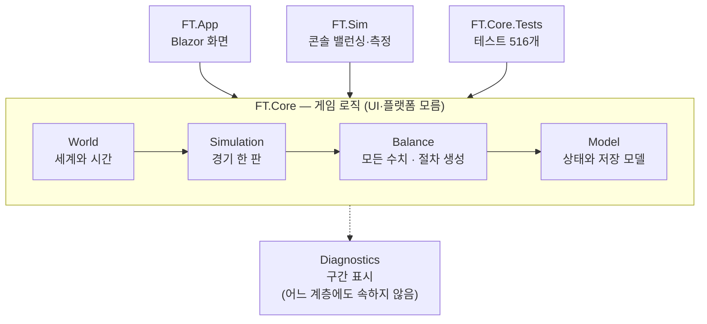
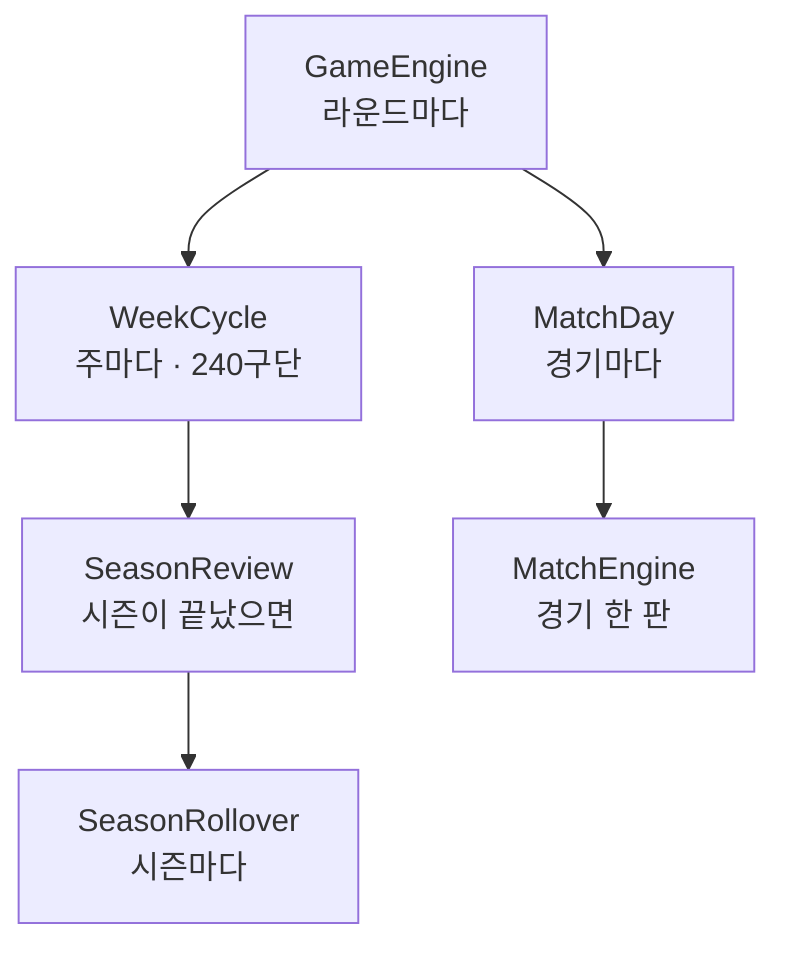

[← 처음으로](../README.md) · [구조](구조.md) · [성능](성능.md) · [밸런싱](밸런싱.md) · [배포](배포.md) · [조심할 것](조심할-것.md) · [바뀐 것](../CHANGELOG.md)

# 구조

프로젝트는 모두 네 개예요. 그림의 **화살표는 "이쪽이 저쪽을 참조한다"는 방향**이고,
늘 한 방향으로만 흐르게 지키고 있어요.



`Diagnostics` 하나만 예외예요. 얘는 아무것도 참조하지 않아서 어느 계층에서든 가져다 쓸 수 있어요.
경기 엔진과 진행 코드가 **둘 다** 시간을 재는데, 이걸 `World` 에 넣어 버리면
`Simulation → World` 로 거꾸로 가는 참조가 생기거든요.

`World` 안의 파일은 **얼마나 자주 도는지**를 기준으로 나눴어요. 라운드 진행을 고치려고
파일을 열었는데 승강 규칙까지 읽고 있게 되는 일은 없어야 하니까요.



## 프로젝트 구성

```
FootballTactician.slnx
├─ FT.Core/            게임 로직. UI 나 플랫폼은 몰라요
│  ├─ Model/           상태와 저장 모델. 아무것도 참조하지 않아요
│  ├─ Balance/         BalanceConfig(모든 수치) · PlayerFactory(절차 생성)
│  ├─ Diagnostics/     SimProfile(구간 표시). 어느 계층에도 속하지 않아요
│  ├─ Simulation/      경기 한 판과 그 주변 — 매치 엔진 · MatchSession · 역할 ·
│  │                   세트피스 · 전술 프로필 · 훈련 · 이사회 · 기자회견 · 중계
│  └─ World/           세계와 시간 — 생성 · 진행 · 이적 · 임대 · 컵 · 커리어 …
├─ FT.Core.Tests/      xUnit 회귀 테스트 516개
├─ FT.Sim/             콘솔 밸런싱·측정 하네스
└─ FT.App/             Blazor WebAssembly 화면
```

### World 안의 파일 — 어느 파일이 언제 도나요

| 파일 | 언제 도나요 | 하는 일 |
|---|---|---|
| `GameWorld` | — | 세계 상태를 들고 있고, 조회를 맡아요(`Squad` · `Strength` · `BestCaAt` · `SeasonFinished`) |
| `WorldGenerator` | 딱 한 번 | 나라·리그·구단·선수·스태프와 첫 일정을 만들어요 |
| `GameEngine` | 라운드마다 | 라운드를 진행하고, 사람이 치르는 경기와 컵 라운드를 걸어요 |
| `MatchDay` | 경기마다 | 라인업 짜기 → 엔진 호출 → 기록 → 체력·사기 반영 |
| `WeekCycle` | 주마다 | 240구단의 훈련·성장·회복·부상·급여, 그리고 이적 창구 |
| `SeasonReview` | 주마다(시즌이 끝났으면) | 이사회 목표를 평가하고 시즌을 결산해요 |
| `SeasonRollover` | 시즌마다 | 승강 · 재계약 · 은퇴 · 보강 · 재정 · 새 일정 |
| `BoardObjectives` | 부임할 때·개막할 때 | 시즌 목표를 만들고 걸러요(한 곳에서만) |
| `SeedMix` · `StaffPlan` · `SquadPeaks` | — | 여러 모듈이 같이 쓰는 작은 공용 도구 |

나머지(`TransferMarket` · `LoanMarket` · `CupCompetition` · `ManagerCareer` · `DressingRoom` ·
`Scouting` · `StaffRoom` · `Homegrown` …)는 기능별 모듈이에요. 위의 주기별 파일들이 필요할 때 불러 써요.

### 결합도를 재 가며 고친 기록 (2026-10-31)

구조는 감으로 고치지 않고 **재 보고** 고쳐요. 파일마다 어떤 타입을 선언하는지, 그 타입을 어느 파일이
쓰는지 세어서 계층 위반 · 순환 · fan-out 을 뽑았어요. `py -I docs/dep.py FT.Core` 를 돌리면
그대로 찍혀 나와요.

| | 전 | 후 |
|---|---|---|
| 계층 규칙 위반 | `Simulation → World` 4회 | 0 |
| 파일 순환 | 12쌍 | 3쌍(셋 다 이유가 있어요, 아래 참고) |
| `GameEngine` | 1,453줄 · 42파일 참조 | 315줄 · 19파일 참조 |

고친 방법은 크게 네 가지였어요.

1. **저장 모델이 로직 파일 안에 들어가 있었어요.** `LoanSpell` 은 `LoanMarket.cs` 에,
   `CupState` 는 `CupCompetition.cs` 에 있었는데, `GameWorld` 가 그 타입들을 들고 있다 보니
   세계가 기능 모듈을 거꾸로 참조하게 됐죠. 순환 12쌍 중 7쌍이 이것 때문이었어요. 전부 `Model/` 로 옮겼어요.
   상태는 상태끼리 모여 있어야 세이브 포맷이 한눈에 들어오거든요.
2. **공용 도구가 신(god) 클래스 안에 들어가 있었어요.** 시드 섞기(`SeedMix`)는 기자실도 컵도 쓰는데
   진행 엔진 안에 있다 보니, 그 모듈들이 엔진을 되짚어 참조하고 있었어요.
3. **신 클래스는 '도는 주기'로 쪼갰어요.** 라운드마다 · 경기마다 · 주마다 · 시즌마다.
   한 파일에 섞여 있으면 라운드를 고치러 들어갔다가 승강 규칙을 읽고 있게 돼요.
4. **같은 규칙이 두 군데 있었어요.** 시즌 목표를 만드는 코드가 부임할 때와 개막할 때 따로 있어서
   한쪽만 고치면 어긋났고, "시즌이 끝났다"는 판단도 함수 두 개에 나뉘어 있었어요. 각각
   `BoardObjectives` 와 `LeagueSeason.Finished` 한 곳으로 모았어요.

남은 순환 3쌍은 일부러 그렇게 둔 것이거나, 세는 방식의 한계예요.

- `MatchEngine ↔ MatchSession` — `Simulate` 가 세션을 거쳐 가게 만든 **일부러 만든 입구**예요.
  길을 둘로 두면 화면에서 직접 치른 경기와 자동으로 돌린 경기의 결과 분포가 달라지거든요.
- `GameWorld ↔ TransferRequests` — `GameWorld.TransferRequests` 라는 **필드 이름**이 클래스 이름과
  같아서 순환으로 세어진 것뿐이에요. 실제 참조는 한 방향이에요(필드 이름을 바꾸면 세이브가 깨져서 그대로 뒀어요).
- `SaveGame ↔ SaveJsonContext` — 소스 생성 직렬화가 원래 이렇게 짝을 이뤄요.

### 같은 일을 두 번 적어 둔 곳 모으기 (2026-11-15)

결합도와는 별개로, 똑같은 코드가 두 군데 적혀 있는 곳도 세어 봤어요. 정규화한 코드 줄을 4~6줄씩
잘라서 두 번 이상 나오는 덩어리를 뽑았어요. 포메이션·역할 데이터 표처럼 원래 비슷하게 생긴 곳을 빼고 나니
진짜 겹치는 곳은 열 군데쯤이었어요.

이런 곳이 무서운 건 **한쪽만 고쳐지기 때문**이에요. 실제로 그렇게 벌어진 차이가 두 개나 있었어요.

- 선수 화면의 관계 이름표에는 친한 동료·비호감·갈등이 빠져 있어서, 갈등 관계가 '동료'로 보였어요.
- 진행 중인 경기 화면과 끝난 경기 화면이 같은 교체를 서로 다르게 적고 있었어요.

모은 곳은 이래요.

| 무엇 | 어디로 |
|---|---|
| 리그 일정·스플릿 일정의 서클 짝짓기 | `FixtureScheduler.CirclePairs` |
| 평소 라운드·시즌 끝 남은 경기의 '라운드 닫기' | `GameEngine.CloseMatchday` |
| 역할 구성 세기(입구 두 개) | `RoleFit.Tally` |
| 세계 생성의 이름 재료 | `WorldGenerator.NamingOf` |
| 화면 갱신 + 저장(23곳) | `GameSession.CommitAsync` |
| 관계 이름 · 이사회 목표 결과 이름 | `Ui.RelationName` · `SeasonReview.ResultLabel` |
| 경기 화면의 점수판 · 타임라인 | `Match.razor` 의 `Scorebug` · `Timeline` |

세계 지문(`83b50b8b23d5d381`)과 시즌 넘김 지문은 하나도 움직이지 않았어요. 동작은 그대로이고
적힌 곳만 줄었다는 뜻이에요.

---

[← 처음으로](../README.md) · [구조](구조.md) · [성능](성능.md) · [밸런싱](밸런싱.md) · [배포](배포.md) · [조심할 것](조심할-것.md) · [바뀐 것](../CHANGELOG.md)
