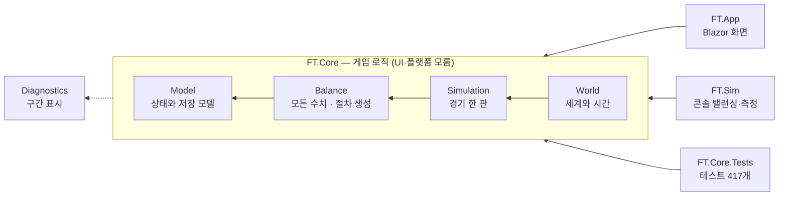
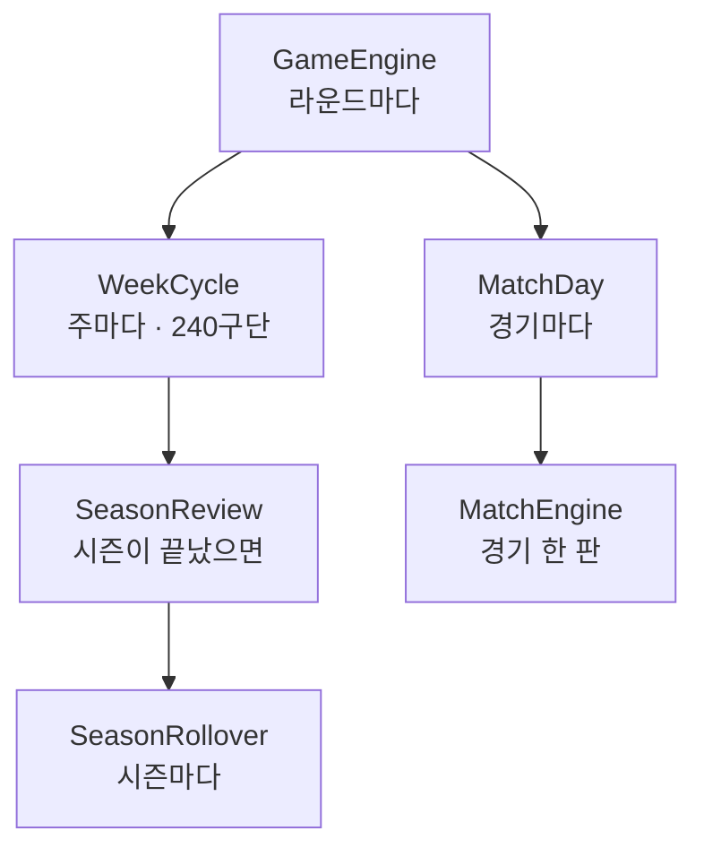

[← 처음으로](../README.md) · [구조](구조.md) · [성능](성능.md) · [밸런싱](밸런싱.md) · [배포](배포.md) · [조심할 것](조심할-것.md) · [바뀐 것](../CHANGELOG.md)

# 구조

프로젝트는 넷입니다. **화살표는 "참조한다" 방향**이고, 한 방향으로만 흐릅니다.



`Diagnostics` 만 예외입니다. 아무것도 참조하지 않아서 어느 계층에서나 쓸 수 있습니다 —
경기 엔진과 진행 코드가 **둘 다** 구간을 찍는데, 이것을 `World` 에 두면
`Simulation → World` 라는 역방향 참조가 생깁니다.

`World` 안의 파일은 **도는 주기**로 갈랐습니다. 라운드를 고치려고 열었다가
승강 규칙을 읽게 되는 일이 없도록.



## 프로젝트 구성

```
FootballTactician.slnx
├─ FT.Core/            게임 로직. UI 와 플랫폼에 의존하지 않는다
│  ├─ Model/           상태와 저장 모델. 아무것도 참조하지 않는다
│  ├─ Balance/         BalanceConfig(모든 수치) · PlayerFactory(절차 생성)
│  ├─ Diagnostics/     SimProfile(구간 표시). 어느 계층에도 속하지 않는다
│  ├─ Simulation/      경기 한 판과 그 주변 — 매치 엔진 · MatchSession · 역할 ·
│  │                   세트피스 · 전술 프로필 · 훈련 · 이사회 · 기자회견 · 중계
│  └─ World/           세계와 시간 — 생성 · 진행 · 이적 · 임대 · 컵 · 커리어 …
├─ FT.Core.Tests/      xUnit 회귀 테스트 417개
├─ FT.Sim/             콘솔 밸런싱·측정 하네스
└─ FT.App/             Blazor WebAssembly 화면
```

### World 안의 파일 — 어느 파일이 언제 도는가

| 파일 | 언제 도는가 | 하는 일 |
|---|---|---|
| `GameWorld` | — | 세계 상태와 조회(`Squad` · `Strength` · `BestCaAt` · `SeasonFinished`) |
| `WorldGenerator` | 한 번 | 나라·리그·구단·선수·스태프·첫 일정 |
| `GameEngine` | 라운드마다 | 라운드 진행, 사람이 치르는 경기, 컵 라운드 걸기 |
| `MatchDay` | 경기마다 | 라인업 짜기 → 엔진 호출 → 기록 → 체력·사기 |
| `WeekCycle` | 주마다 | 240구단 훈련·성장·회복·부상·급여, 이적 창구 |
| `SeasonReview` | 주마다(끝났으면) | 이사회 목표 평가와 시즌 결산 |
| `SeasonRollover` | 시즌마다 | 승강 · 재계약 · 은퇴 · 보강 · 재정 · 일정 재생성 |
| `BoardObjectives` | 부임·개막 | 시즌 목표 생성과 거르기(한 곳에서) |
| `SeedMix` · `StaffPlan` · `SquadPeaks` | — | 여러 모듈이 같이 보는 작은 공용물 |

나머지(`TransferMarket` · `LoanMarket` · `CupCompetition` · `ManagerCareer` · `DressingRoom` ·
`Scouting` · `StaffRoom` · `Homegrown` …)는 기능별 모듈이고, 위의 주기 파일들이 불러 씁니다.

### 결합도를 재고 고친 기록 (2026-10-31)

구조는 느낌이 아니라 **재서** 고칩니다. 파일마다 선언된 타입과 그 타입을 쓰는 파일을 세어
계층 위반 · 순환 · fan-out 을 뽑았습니다 — `py -I docs/dep.py FT.Core` 가 그대로 찍어 줍니다.

| | 전 | 후 |
|---|---|---|
| 계층 규칙 위반 | `Simulation → World` 4회 | 0 |
| 파일 순환 | 12쌍 | 3쌍(아래 전부 설명 가능) |
| `GameEngine` | 1,453줄 · 42파일 참조 | 315줄 · 19파일 참조 |

고친 방법은 네 가지였습니다.

1. **저장 모델이 로직 파일 안에 살고 있었습니다.** `LoanSpell` 은 `LoanMarket.cs` 에,
   `CupState` 는 `CupCompetition.cs` 에 선언돼 있었고, `GameWorld` 가 그 타입을 들고 있으니
   세계가 기능 모듈을 거꾸로 참조했습니다 — 순환 12쌍 중 7쌍이 이것이었습니다. `Model/` 로 옮겼습니다.
   상태는 상태끼리 모여 있어야 세이브 포맷을 한눈에 볼 수 있습니다.
2. **공용 유틸이 신(god) 클래스 안에 있었습니다.** 시드 섞기(`SeedMix`)는 기자실도 컵도 쓰는데
   진행 엔진 안에 있어서, 그 모듈들이 엔진을 되참조했습니다.
3. **신 클래스는 '도는 주기'로 갈랐습니다.** 라운드마다 · 경기마다 · 주마다 · 시즌마다.
   같은 파일에 섞여 있으면 라운드를 고치려고 열었다가 승강 규칙을 읽습니다.
4. **같은 규칙이 두 곳에 있었습니다.** 시즌 목표 생성이 부임과 개막에 따로 있었고(한쪽만 고치면
   어긋남), "시즌이 끝났다"의 뜻이 두 함수에 있었습니다. 각각 `BoardObjectives` 와
   `LeagueSeason.Finished` 한 곳으로 모았습니다.

남은 순환 3쌍은 의도한 것이거나 측정의 한계입니다.

- `MatchEngine ↔ MatchSession` — `Simulate` 가 세션을 거치게 한 **의도된 입구**입니다.
  경로를 둘로 두면 화면에서 치른 경기와 자동으로 돌린 경기의 분포가 달라집니다.
- `GameWorld ↔ TransferRequests` — `GameWorld.TransferRequests` 라는 **필드 이름**이 클래스
  이름과 같아서 세어진 것입니다. 실제 참조는 한 방향입니다(필드 이름을 바꾸면 세이브가 깨집니다).
- `SaveGame ↔ SaveJsonContext` — 소스 생성 직렬화의 짝입니다.

---

[← 처음으로](../README.md) · [구조](구조.md) · [성능](성능.md) · [밸런싱](밸런싱.md) · [배포](배포.md) · [조심할 것](조심할-것.md) · [바뀐 것](../CHANGELOG.md)
