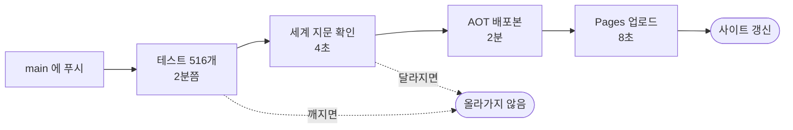

[← 처음으로](../README.md) · [구조](구조.md) · [성능](성능.md) · [밸런싱](밸런싱.md) · [배포](배포.md) · [조심할 것](조심할-것.md) · [바뀐 것](../CHANGELOG.md)

# 배포

**평소에는 따로 손댈 게 없어요.** `main` 에 앱 코드가 들어오면 Actions 가 알아서 사이트에 올려 줘요
(`.github/workflows/pages.yml`). 한 번 도는 데 **5분쯤** 걸려요.



테스트가 하나라도 깨지거나 세계 지문이 달라지면 거기서 멈추고 아무것도 올라가지 않아요.
README 나 문서만 고친 푸시로는 돌지 않아요 — 바뀐 게 없는데 다시 만들 이유가 없으니까요.
손으로 한 번 돌리고 싶으면 Actions 탭 → "배포" → Run workflow 를 누르면 돼요.

→ **https://sundae-unity-dev.github.io/Football-TacticManager/**

## 버전을 올릴 때

버전 숫자는 **세 군데**에 똑같이 들어가 있어야 해요. 순서는 이렇게 가요.

```bash
# 1) 세 군데를 고쳐요.
#    FT.App/FT.App.csproj 의 <Version>   → 시작 화면에 찍히는 값
#    README.md 의 '지금 버전' 줄          → 저장소 첫 화면에 보이는 값
#    CHANGELOG.md 맨 위에 새 칸           → 사람이 읽는 값
# 2) main 에 합쳐요.                       → Actions 가 올려요
git commit -am "..." && git push

# 3) Actions 가 끝나고, 사이트에서 새 버전이 뜨는 걸 눈으로 확인해요.
# 4) 그다음에 태그와 릴리스를 달아요.
git tag -a v0.1.1 -m "한 줄 요약"
git push origin v0.1.1
gh release create v0.1.1 --title "v0.1.1 — 한 줄 요약" --notes-file 그_칸.md
```

마지막 줄의 `그_칸.md` 는 CHANGELOG 에 쓴 칸을 그대로 떼어 낸 파일이에요. 두 곳에 따로 글을 쓰면
꼭 한쪽이 낡더라고요. 한 번 쓴 걸 그대로 붙여 넣는 게 제일 안전해요.

패치(0.1.**1**)는 고친 것과 빨라진 것, 마이너(0.**2**.0)는 새로 할 수 있게 된 것이에요.
`SaveGame.FormatVersion` 이 올라가서 **예전 세이브를 못 읽게 되는 변경**이면 CHANGELOG 에 ⚠ 를 붙이고,
무엇이 깨지는지 그 칸에 꼭 적어 주세요.

태그는 꼭 **사이트에 올라간 걸 확인한 뒤에** 달아요. 배포가 깨진 채로 태그를 먼저 달면, 그 태그가 가리키는
커밋이 실제로는 한 번도 서비스된 적 없는 상태가 돼요. 나중에 "v0.1.1 에서 이랬지" 하고 되짚을 때
이 어긋남이 제일 헷갈려요.

## 손으로 나르던 길은 없앴어요

예전에는 배포본을 `gh-pages` 브랜치에 밀어 넣는 `tools/deploy-pages.sh` 가 있었어요. 그런데 한 번 쓸 때마다
저장소가 **24MB씩** 불어나고, Settings → Pages 에서 소스를 손으로 되돌려야 했어요. 지금처럼 아티팩트로
올리면 그런 짐이 없어요.

Actions 가 막히면 Run workflow 로 다시 돌려 보세요. 그래도 안 되면 지운 스크립트가 히스토리에 남아 있어요 —
`git log --diff-filter=D -p -- tools/deploy-pages.sh`.

## Pages 가 아는 것과 모르는 것

Pages 는 저장소 이름이 붙은 주소로 사이트를 띄우고, 클라이언트 라우팅이나 내용 협상은 몰라요.
그래서 `tools/prepare-pages.sh` 가 배포본을 다섯 군데 손봐요. 워크플로도 **이 파일 하나**를 그대로 써요.
두 길이 갈라지면 한쪽만 깨지는데, 그게 제일 찾기 어렵거든요.

| 손보는 것 | 안 하면 이렇게 돼요 |
|---|---|
| `<base href>` → `/Football-TacticManager/` | `_framework` 를 도메인 뿌리에서 찾다가 전부 404 가 나요 |
| `.nojekyll` | Jekyll 이 밑줄로 시작하는 폴더(`_framework`)를 숨겨 버려요 |
| `404.html` = `index.html` | `/squad` 에서 새로고침하면 Pages 의 404 화면이 떠요 |
| `.gitattributes` 에 `* -text` | 줄바꿈이 바뀌면서 integrity 해시가 깨져요 (아래 이야기) |
| `.br`/`.gz` 삭제 | Pages 가 알아보지 못해서 용량만 두 배가 돼요 |

### 줄바꿈 때문에 한 번 크게 데였어요

빌드 산출물을 git 으로 나를 때는 줄바꿈을 정말 조심해야 해요. 저장소 뿌리의 `.gitattributes` 가 소스를 LF 로
맞추는데, 그 규칙이 배포본에도 걸려 버렸어요. 그 바람에 `dotnet.js` 가 CRLF → LF 로 바뀌면서 **310바이트**
줄었어요. 그런데 `index.html` 에 박힌 integrity 해시는 줄기 전 바이트로 계산된 값이라, 브라우저가 파일을
다 받아 놓고도 해시가 다르다며 버렸어요.

화면은 "불러오는 중"에서 그대로 멈췄고, 콘솔에만 `Failed to fetch dynamically imported module` 이 찍혔어요.
네트워크 탭에는 200 으로 멀쩡하게 보여서 서버부터 의심하게 되더라고요.

브랜치로 나르는 길은 없앴지만, 이때 배운 건 `prepare-pages.sh` 안에 `* -text` 로 남겨 뒀어요.
**빌드 산출물은 한 바이트도 바뀌면 안 돼요.**

### 압축 파일은 올리지 않아요

`.br`/`.gz` 는 올리지 않아요. Pages 는 내용 협상을 안 해서 그 파일을 알아보지 못하고, 대신 자기가 gzip 으로
압축해서 보내 줘요. 그래서 실제로 받는 양은 **7.25MB** 예요. brotli 를 쓸 수 있었다면 5.15MB 였을 텐데,
Pages 가 gzip 만 지원해서 어쩔 수 없어요.

---

[← 처음으로](../README.md) · [구조](구조.md) · [성능](성능.md) · [밸런싱](밸런싱.md) · [배포](배포.md) · [조심할 것](조심할-것.md) · [바뀐 것](../CHANGELOG.md)
