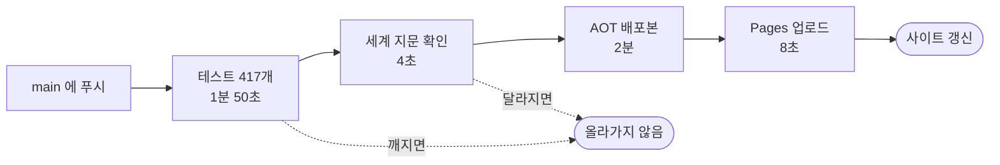

[← 처음으로](../README.md) · [구조](구조.md) · [성능](성능.md) · [밸런싱](밸런싱.md) · [배포](배포.md) · [조심할 것](조심할-것.md) · [바뀐 것](../CHANGELOG.md)

# 배포

**평소에는 손댈 것이 없습니다.** `main` 에 앱 코드가 들어오면 Actions 가 알아서 올립니다.



README·문서만 고친 푸시로는 돌지 않습니다. 바뀌지 않은 것을 다시 만들 이유가 없습니다.

## 버전을 올릴 때

버전은 세 곳에 같은 숫자가 있어야 합니다. **두 줄 고치고 태그 하나 밀면** 끝입니다.

```bash
# 1) FT.App/FT.App.csproj 의 <Version> 을 고칩니다.        → 시작 화면에 찍히는 값
# 2) CHANGELOG.md 맨 위에 새 칸을 씁니다.                   → 사람이 읽는 값
git commit -am "..." && git push                          # → Actions 가 올립니다

# 3) 올라간 것을 확인한 뒤 태그를 답니다.
git tag -a v0.1.1 -m "한 줄 요약"
git push origin v0.1.1
gh release create v0.1.1 --title "v0.1.1 — 한 줄 요약" --notes-file 그_칸.md
```

마지막 줄의 `그_칸.md` 는 CHANGELOG 에 쓴 칸을 그대로 떼어 둔 파일입니다. 두 곳에
다른 말을 쓰면 반드시 한쪽이 낡습니다 — 쓴 것을 붙여 넣는 쪽이 맞습니다.

패치(0.1.**1**)는 고친 것과 빨라진 것, 마이너(0.**2**.0)는 새로 할 수 있게 된 것입니다.
`SaveGame.FormatVersion` 이 올라가 **예전 세이브를 못 읽게 되는 변경**은 CHANGELOG 에
⚠ 를 붙이고, 무엇이 깨지는지 그 칸에 적습니다.

태그를 **올린 뒤에** 다는 것이 순서입니다. 배포가 깨지면 태그가 가리키는 커밋이
실제로 서비스되지 않은 상태가 되는데, 나중에 "v0.1.1 에서 그랬다"를 되짚을 때
그 어긋남이 제일 헷갈립니다.

## 배포 (GitHub Pages)

**평소에는 손댈 것이 없습니다.** `main` 에 앱 코드가 들어오면 Actions 가 올립니다
(`.github/workflows/pages.yml`) — 테스트 417개 → 세계 지문 확인 → AOT 배포본 → Pages.
한 번에 **5분쯤**입니다(테스트 1분50초 · AOT 2분). 손으로 돌리려면 Actions 탭 → "배포"
→ Run workflow. README·문서만 고친 푸시로는 돌지 않습니다.

→ **https://sundae-unity-dev.github.io/Football-TacticManager/**

**손으로 나르는 길은 없앴습니다.** 예전에는 배포본을 `gh-pages` 브랜치에 밀어 넣는
`tools/deploy-pages.sh` 가 있었는데, 한 번 쓸 때마다 저장소가 **24MB씩** 불어나고
Settings → Pages 에서 소스를 손으로 되돌려야 했습니다. 아티팩트로 올리는 지금 길은
그 짐을 지지 않습니다. Actions 가 막히면 Run workflow 로 다시 돌리면 되고, 그래도
안 되면 지워진 스크립트가 히스토리에 남아 있습니다 —
`git log --diff-filter=D -p -- tools/deploy-pages.sh`.

### Pages 가 아는 것과 모르는 것

Pages 는 저장소 이름이 붙은 주소로 서비스하고, 클라이언트 라우팅도 내용 협상도 모릅니다.
그래서 `tools/prepare-pages.sh` 가 배포본을 다섯 군데 손봅니다. **워크플로와 같은 이
파일 하나**를 씁니다 — 두 길이 갈라지면 한쪽만 깨지고, 그게 제일 찾기 어렵습니다.

| 손보는 것 | 안 하면 |
|---|---|
| `<base href>` → `/Football-TacticManager/` | `_framework` 를 도메인 뿌리에서 찾아 전부 404 |
| `.nojekyll` | Jekyll 이 밑줄로 시작하는 폴더(`_framework`)를 숨깁니다 |
| `404.html` = `index.html` | `/squad` 를 새로고침하면 Pages 의 404 화면이 나옵니다 |
| `.gitattributes` 에 `* -text` | 줄바꿈이 바뀌어 integrity 해시가 깨집니다 (아래) |
| `.br`/`.gz` 삭제 | Pages 가 알아보지 못해 용량만 두 배가 됩니다 |

**빌드 산출물을 git 으로 나르면 줄바꿈을 조심하세요.** 한 번 데였습니다. 뿌리의
`.gitattributes` 가 소스를 LF 로 맞추는데 그 규칙이 배포본에도 걸려서, `dotnet.js` 가
CRLF → LF 로 **310바이트 줄었습니다**. `index.html` 에 박힌 integrity 해시는 줄기 전
바이트로 계산된 값이라, 브라우저가 파일을 다 받아 놓고 해시가 다르다며 버렸습니다.
화면은 "불러오는 중"에서 멈추고 콘솔에만 `Failed to fetch dynamically imported module` 이
찍혔습니다 — 네트워크 탭에는 200 으로 보여서 서버를 의심하기 쉽습니다.
브랜치로 나르는 길은 없앴지만 교훈은 `prepare-pages.sh` 안에 `* -text` 로 남아 있습니다.
**빌드 산출물은 한 바이트도 바뀌면 안 됩니다.**

`.br`/`.gz` 는 올리지 않습니다. Pages 는 내용 협상을 하지 않아 그 파일을 알아보지 못하고,
대신 자기가 gzip 으로 압축해서 보냅니다. 실제로 받는 양은 **7.25MB** 입니다
(brotli 로 줄 수 있었다면 5.15MB 였을 것입니다 — Pages 가 gzip 만 합니다).

---

[← 처음으로](../README.md) · [구조](구조.md) · [성능](성능.md) · [밸런싱](밸런싱.md) · [배포](배포.md) · [조심할 것](조심할-것.md) · [바뀐 것](../CHANGELOG.md)
